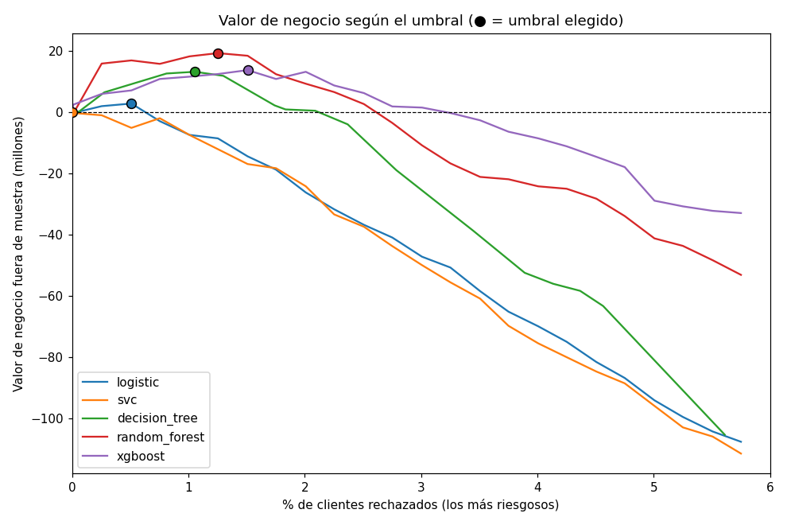

# Módulo 5 · Predicción de pago a tiempo, umbral de negocio 

Proyecto de *machine learning* supervisado para una entidad de crédito. El modelo estima si un cliente **pagará su préstamo a tiempo**, se decide a partir de qué riesgo conviene **rechazar** un crédito usando una métrica de negocio.

## Caso de negocio

Cuando una entidad otorga un crédito puede equivocarse de dos maneras, y cada error cuesta distinto:

| Decisión | Si el cliente **no paga a tiempo** | Si el cliente **paga a tiempo** |
|---|---|---|
| **Rechazar** (el modelo predice "no paga") | Se evita una pérdida | Se pierde el margen del crédito |
| **Aprobar** | Se asume la pérdida | Se gana el margen |

Un modelo que rechaza demasiado destruye valor, porque pierde buenos clientes. Uno que rechaza poco no protege de las pérdidas. Por eso el modelo no se evalúa solo con métricas estadísticas: el **umbral de decisión** se elige para maximizar un **valor de negocio**.

### Métrica de negocio

Frente a la referencia de aprobar a todos (valor 0):

- Rechazar a un cliente que no pagaba: `+ capital × pérdida` (pérdida evitada).
- Rechazar a un cliente que sí pagaba: `− capital × margen` (margen perdido).

> ⚠️ **Supuestos.** La base no trae márgenes ni pérdidas reales, y la cuota por el plazo no alcanza a cubrir el capital en el 91 % de los casos, así que no se pueden derivar de los datos. Se asumen **pérdida = 30 %** y **margen = 10 %** del capital. Están en `CONFIG_NEGOCIO` (`model_training.ipynb`) y todo el flujo se recalcula al cambiarlos. Conviene validarlos con el área de negocio.

## Datos

`Base_de_datos.xlsx`: 10.763 préstamos (de noviembre de 2024 a abril de 2026) y 23 columnas con datos del crédito, del cliente y de su historial en centrales de riesgo.

- **Target** `Pago_atiempo`: 1 = paga a tiempo, 0 = no paga. Está muy desbalanceado: ~95 % paga y ~5 % no.
- **Nulos:** `promedio_ingresos_datacredito` y `tendencia_ingresos` tienen ~27 %.
- Tras la limpieza quedan 10.760 filas: 8.608 para entrenar y 2.152 para evaluar (102 morosos).

## Estructura del proyecto

```
modulo5/
├── Base_de_datos.xlsx          # datos de entrada
├── requeriments.txt            # dependencias
├── README.md
├── docs/                       # imágenes del README
├── salidas/                    # se genera al ejecutar (gráficos, tablas, modelo)
└── src/
    ├── cargar_datos.py         # lectura de la base
    ├── comprension_eda.ipynb   # análisis exploratorio y calidad de datos
    ├── ft_engineering.py       # limpieza, split y preprocesamiento (v1.0.1)
    ├── model_training.ipynb    # entrenamiento, umbral y selección (v1.1.2)
    └── model_evaluation.py     # tablas y gráficos comparativos (v1.1.2)
```

## Instalación

```bash
python -m venv venv
source venv/bin/activate        # en Windows: venv\Scripts\activate
pip install -r requeriments.txt
```

## Cómo ejecutarlo

Los pasos van en este orden, porque cada uno usa lo que genera el anterior:

| # | Qué | Comando |
|---|---|---|
| 1 | Análisis exploratorio | abrir `src/comprension_eda.ipynb` |
| 2 | Entrenar, ajustar el umbral y guardar el modelo | ejecutar `src/model_training.ipynb` (Run All) |
| 3 | Tabla resumen y gráficos | `python src/model_evaluation.py` |


Los resultados se guardan en `salidas/`. El paso 2 genera el modelo ganador, el preprocesador y `config_modelo.json` (con el umbral), que necesita el monitoreo.

## Proceso

1. **EDA** (`comprension_eda.ipynb`): detecta problemas de calidad y relaciones con el target. Ejemplos: edades imposibles, tipos de crédito casi sin uso y tendencias de ingresos con valores inválidos.
2. **Ingeniería de características** (`ft_engineering.py`): limpieza según el EDA, división 80/20 estratificada y `ColumnTransformer` (numéricas con imputación por mediana, categóricas con imputación por moda más *OneHot*, ordinal con *OrdinalEncoder*). El preprocesador se ajusta **solo con train**, para no filtrar información del test.
3. **Entrenamiento** (`model_training.ipynb`): regresión logística, SVC lineal, árbol de decisión, random forest y XGBoost, todos con manejo del desbalance de clases.
4. **Ajuste del umbral:** para cada modelo se busca el umbral que maximiza el valor de negocio, con predicciones **fuera de muestra** (validación cruzada) sobre train. El conjunto de test se usa una sola vez, para medir el resultado.
5. **Selección:** se elige el modelo con mayor valor de negocio fuera de muestra, sin mirar test.

## Resultados

Sobre 2.152 clientes de test, con el **umbral ajustado**:

| Modelo | Rechaza | Recall (no paga) | Precisión | Valor de negocio | ROC AUC |
|---|---|---|---|---|---|
| **random_forest** (seleccionado) | 29 | 0,08 | 0,28 | **+3,7 M** | 0,69 |
| decision_tree | 10 | 0,04 | 0,40 | +2,5 M | 0,61 |
| xgboost | 39 | 0,07 | 0,18 | +0,4 M | 0,65 |
| svc | 0 | 0,00 | — | 0,0 M | 0,68 |
| logistic | 7 | 0,01 | 0,14 | −0,6 M | 0,68 |

Efecto del umbral sobre el valor de negocio en test (en millones):

| Modelo | Umbral por defecto | Umbral ajustado |
|---|---|---|
| random_forest | −50,9 | +3,7 |
| decision_tree | −125,9 | +2,5 |
| xgboost | −12,3 | +0,4 |
| logistic | −143,7 | −0,6 |
| svc | −144,9 | 0,0 |



## Hallazgos principales

1. **`puntaje` se excluye por fuga de información.** Separa perfectamente a pagadores de no pagadores (los que no pagan tienen `puntaje` ≤ 62,7 y los que pagan ≥ 63,8). Un score así probablemente se calcula conociendo el resultado. Para volver a incluirlo: `ft_engineering(excluir_features=[])`.
2. **Los datos tienen poca señal.** Sin `puntaje`, el ROC AUC ronda 0,61–0,69 y los modelos más flexibles (random forest, XGBoost) memorizan train y generalizan peor.
3. **El umbral por defecto destruye valor.** Con 0,5, la regresión logística rechaza a 766 clientes y pierde 144 M frente a aprobar a todos. Con el umbral ajustado, el mejor punto se alcanza rechazando solo al ~1 % de los clientes más riesgosos.
4. **El mejor modelo cambia según el criterio.** Por recall y ROC AUC ganaba la regresión logística. Con el valor de negocio gana el **random forest**, y en las pruebas de sensibilidad (pérdida de 50 % y 80 %, margen de 20 %) siguió siendo el mejor entre los modelos de scikit-learn.
5. **El valor que aporta es modesto.** El random forest captura ~4 % del valor máximo posible y detecta 8 de los 102 morosos de test. Conviene usarlo como un **filtro selectivo** que señala casos de mayor riesgo para revisión, no como rechazo automático.

## Limitaciones y próximos pasos

- **Validar los supuestos de costos** (pérdida 30 %, margen 10 %) con el área de negocio. Todo el ajuste del umbral depende de ellos.
- **Pocos morosos en test** (102): las diferencias entre modelos están dentro del margen de error. Conviene confirmar con más datos o validación cruzada repetida.
- **`Pago_atiempo` no es lo mismo que un incumplimiento definitivo.** La pérdida asumida debería reflejar pagos tardíos, no solo impagos.
- **Calibrar las probabilidades** y evaluar un corte temporal con `fecha_prestamo` en lugar de una división aleatoria.

